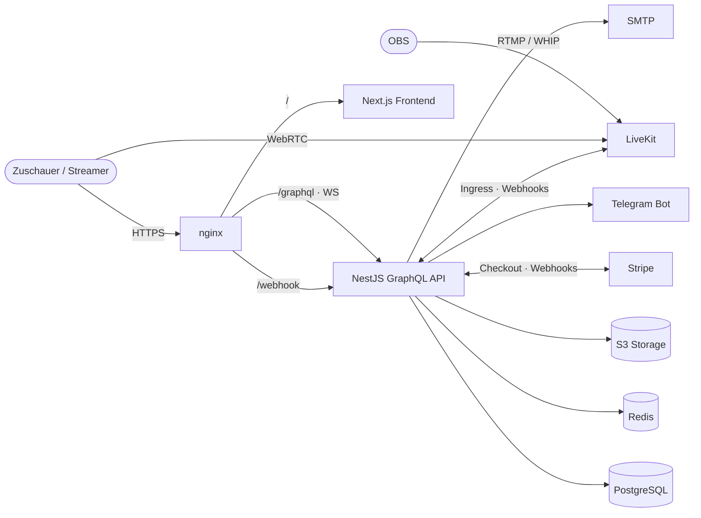

<div align="center">


# TeaStream

**Eine Full-Stack-Livestreaming-Plattform: Streams, Live-Chat, Follows und Sponsoring mit echten Zahlungen.**

[](https://github.com/Kiwious/tea-stream/actions/workflows/deploy.yml)


</div>

---

## Über das Projekt

TeaStream ist eine Streaming-Plattform nach dem Vorbild von Twitch. Nutzer können per OBS (RTMP oder WHIP) live gehen, Zuschauer chatten in Echtzeit, folgen Kanälen und unterstützen Streamer über bezahlte Sponsoring-Abos. Das Projekt deckt den gesamten Weg ab: von der Datenbank über eine typsichere GraphQL-API bis zum Frontend und einem automatisierten Deployment auf einen eigenen Server.

## Features

| | |
| --- | --- |
| 🎥 **Livestreaming** | Stream-Keys per LiveKit-Ingress (RTMP/WHIP), Live-Status über Webhooks, Thumbnails, Kategorien |
| 💬 **Live-Chat** | Echtzeit-Chat pro Stream über GraphQL-Subscriptions (WebSockets), Chat-Einstellungen für Streamer |
| 💳 **Sponsoring** | Eigene Sponsoring-Pläne, Abos und Transaktionshistorie über Stripe Checkout + Webhooks |
| 🔐 **Authentifizierung** | Session-basiert mit Redis, Argon2-Hashing, E-Mail-Verifizierung, Passwort-Reset, TOTP-2FA, Geräteübersicht mit Standort |
| 🔔 **Benachrichtigungen** | In-App, per E-Mail (React-Email-Templates) und über einen Telegram-Bot, pro Nutzer konfigurierbar |
| 👤 **Profile & Kanäle** | Avatar-Upload (S3 + `sharp`), Social Links mit Drag-&-Drop-Sortierung, Follower, empfohlene Kanäle |
| 📊 **Creator-Dashboard** | Stream-Keys, Chat, Follower, Sponsoren, Pläne und Transaktionen an einem Ort |
| 🎨 **UI** | Dark/Light-Theme, wählbare Akzentfarbe, Mehrsprachigkeit (Deutsch/Englisch), SEO mit Sitemap & Manifest |
| ⏱️ **Cron-Jobs** | Automatisches Löschen deaktivierter Accounts, Kanal-Verifizierung, 2FA-Erinnerungen, Aufräumen alter Benachrichtigungen |

## Tech-Stack

**Frontend**: [`frontend/`](frontend)

- Next.js 16 (App Router), React 19, TypeScript
- Apollo Client 4 mit GraphQL Codegen (generierte, typsichere Hooks)
- Tailwind CSS 4, shadcn/ui, lucide-react
- LiveKit Components für den Player
- react-hook-form + Zod, Zustand, next-intl, next-themes

**Backend**: [`backend/`](backend) ([eigene README](backend/README.md))

- NestJS 12 auf Express 5
- GraphQL Code-First mit Apollo Server 5, inklusive Subscriptions und Datei-Uploads
- Prisma 7 mit PostgreSQL, Redis für Sessions
- LiveKit Server SDK, Stripe, S3, Nodemailer, Telegraf

**Infrastruktur**

- Docker Compose (Postgres, Redis, Backend, Frontend)
- nginx als Reverse Proxy (`/graphql`, `/webhook/`, `/`)
- GitHub Actions: Type-Check & Build beider Apps, danach Deployment per SSH

## Architektur



## Projektstruktur

```
tea-stream/
├── backend/                 # NestJS GraphQL-API
│   ├── prisma/              # Schema + versionierte Migrationen
│   ├── scripts/             # Seed-Assets nach S3 laden
│   └── src/
│       ├── core/            # Config, GraphQL, Prisma, Redis
│       ├── modules/         # auth, stream, chat, follow, sponsorship, notification, ...
│       └── shared/          # Guards, Decorators, Pipes, Utils
├── frontend/                # Next.js App
│   ├── app/                 # Routen (Startseite, Kanäle, Kategorien, Dashboard, Account)
│   ├── components/          # Feature- und Layout-Komponenten, UI-Bausteine
│   ├── graphql/             # .graphql-Operationen + generierter Code
│   └── public/languages/    # Übersetzungen (de, en)
├── nginx/                   # Reverse-Proxy-Konfiguration
├── docker-compose.yml       # Lokale Entwicklung (Postgres + Redis)
├── docker-compose.prod.yml  # Produktion (komplette Plattform)
└── deploy.sh                # Deploy-Skript für den Server
```

## Lokal starten

**Voraussetzungen:** Node.js 22+, Yarn, Bun, Docker, sowie Zugänge für LiveKit, Stripe, einen S3-kompatiblen Storage, SMTP und einen Telegram-Bot.

```bash
# 1. Repository klonen und Umgebungsvariablen anlegen
git clone https://github.com/Kiwious/tea-stream.git
cd tea-stream
cp .env.example .env          # Werte ausfüllen

# 2. PostgreSQL und Redis starten
docker compose up -d

# 3. Backend
cd backend
yarn install
yarn db:push                  # Migrationen anwenden
yarn db:seed                  # Testdaten: Kategorien, Kanäle, Streams
yarn start:dev

# 4. Frontend (zweites Terminal)
cd frontend
bun install
bun dev                       # führt vorher automatisch GraphQL Codegen aus
```

Das Frontend läuft danach auf [http://localhost:3000](http://localhost:3000). Details zu Scripts, Webhooks und dem Prisma-Workflow stehen in der [Backend-README](backend/README.md).

## Deployment

Jeder Push auf `main` startet den [Deploy-Workflow](.github/workflows/deploy.yml):

1. **Checks:** Backend wird gebaut, das Frontend type-gecheckt (inklusive generierter Next.js-Routentypen).
2. **Deploy:** Per SSH wird auf dem Server [`deploy.sh`](deploy.sh) ausgeführt. Das Skript zieht den neuen Stand und baut zuerst Datenbank, Redis und Backend. Das Frontend folgt erst, wenn das Backend gesund ist, weil der Next.js-Build Seiten gegen die öffentliche API vorrendert.

Alle Container lauschen nur auf `127.0.0.1`; von außen ist ausschließlich nginx erreichbar.

---

<div align="center">
<sub>Entwickelt von <a href="https://github.com/Kiwious">Kiwious</a> als Portfolio-Projekt.</sub>
</div>
